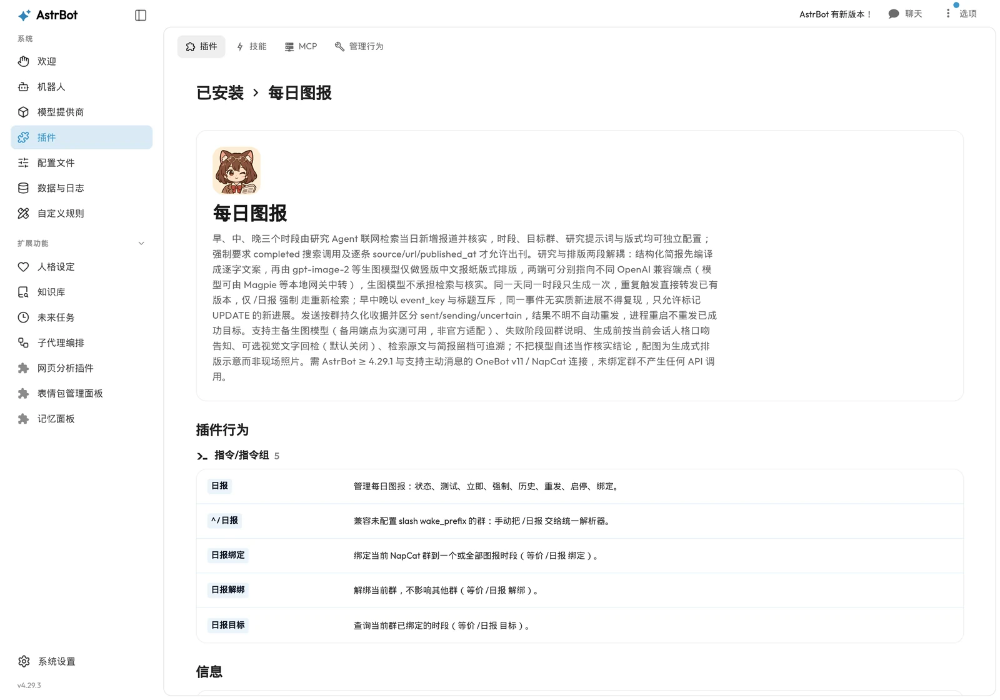
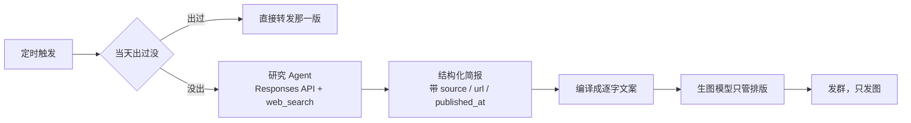

<div align="center">

[](https://github.com/Cnxiaohun/astrbot_plugin_daily_image_report/releases)


# 每日图报

<sub>每天准点给群里送一份报纸。</sub>

**AstrBot 插件：早中晚三档定时，研究 Agent 联网核实当日资讯，编译成逐字文案后交给生图模型排成竖版中文报纸，只发图片到绑定的群。**

</div>

---

自用插件，跑在我自己的 AstrBot 上，每天往「吴某的乐子群」发早报、午报、晚报。顺手开源，主要是留个备份，换机器时不用重写一遍。

默认配置是围着我这个群调的（刊名、右上角群名、三档时间），你换环境要改。它也不是通用资讯推送器，没打算做成大而全的东西。

## 效果

1024×1536 竖版报纸图：

<a href="docs/images/sample-morning.webp"></a>
<a href="docs/images/sample-noon.webp"></a>

| 时段 | 默认时间 | 侧重 |
|---|---|---|
| 早报 | 08:00 | 昨夜到今晨的国际要闻，外加历史上的今天 |
| 午报 | 12:30 | 上午的财经、产业、AI、能源与监管 |
| 晚报 | 19:00 | 白天事件的后续，以及明天要盯什么 |

WebUI 里就是普通插件的样子：

<a href="docs/images/ui-plugin-detail.webp"></a>
<a href="docs/images/ui-plugin-info.webp"></a>

## 能力清单

- **一个时段可以绑多个群。** `targets` 是列表，早报可以只发 A 群、晚报同时发五个群；反过来一个群也能同时收三档。
- **逐群独立发送收据。** 每个目标单独记 `sent` / `sending` / `uncertain`，五群里有一群发失败只补那一群，已成功的绝不重发。
- **三档完全独立配置。** 时间、模式、研究提示词、图片提示词、模型、尺寸、质量、目标群各档互不影响。
- **绑群有三种方式。** 群内发 `/日报 绑定 全部`（自动取当前群，用的是真实群号而不是隔离到个人的会话 ID）、WebUI 的会话来源选择器、或者手填 UMO。
- **两种生成模式。** `agent` 走联网研究；`static` 用你自己写的固定提示词直接出图，适合节日海报、早安图这类不需要资讯的场景。
- **主备模型链。** 主模型挂了按 `fallback_image_models` 顺序往下试，运行记录里会写明实际用的是哪个。
- **当天只出一次。** 同一天同一档重复触发不再调 API，直接转发已有那张；只有 `/日报 强制` 会重新检索重新画。
- **跨刊去重。** 早中晚之间传递当天已出刊的标题和 `event_key`，同一件事没有新进展不许再占版面，标 `UPDATE` 才放行。
- **失败不沉默。** 生成失败会在群里说明卡在哪个阶段、原因摘要、怎么重试；另外可以配 `alert_umo` 把失败单独发给管理员。
- **开工前用人格说一声。** 调一次很短的模型请求，把「开始做 12:30 的午报」换成群里那个人设的语气，改不动就退回原句。
- **全程留档。** `brief.json`（结构化简报）、`evidence.json`（原始搜索调用与来源）、`research_prompt.txt` / `image_prompt.txt`（实际发出的提示词）、`meta.json`（模型、耗时、token、图片尺寸与哈希）。
- **可选视觉回检。** 打开 `qa.enabled` 后用视觉模型核对图上的刊头、日期、群标识和标题是否齐全，不通过就不发群。
- **错过会补，但只在窗口内。** 重启或卡住导致错过定时，`catchup_window_minutes`（默认 30 分钟）内补一次，超过就不补——不会半夜突然弹出早报。
- **成本有闸。** `max_runs_per_day`、`max_concurrent_generations`、整个运行的硬超时 `stale_run_minutes`；研究超时会自动重试一次，生图超时不重试。

## 一条前提

生图模型不联网。你让它「画今天的新闻」，它会编出三条看着挺像那么回事、实际查无此事的标题——这坑我踩过。所以查和画是拆开的：



研究请求里必须真的出现 `completed` 的 `web_search_call`，每条新闻都得带来源链接和发布时间，否则当天判失败、不出报。

还是那句：插件保证的是**可追溯**，不是已核实。模型照样会误读、会引旧稿，敏感内容自己抽查。

顺带一提，我这里 `gpt-image-2`、`hunyuan-image-alpha` 和研究用的 `codex/gpt-6.1-sol` 都不是直连官方 API，而是走 [Magpie](https://github.com/yetone/magpie) 这个本地网关中转出来的 OpenAI 兼容端点。插件只认 `base_url`，所以换官方 API、换 New API、换自建代理都行，不用改代码。

## 关于模型端点

这个插件只认 `base_url`，所以底下接什么由你决定，但两种玩法的坑完全不一样：

**走 Magpie 的 Codex 授权**（我这套默认配置就是：`codex/gpt-6.1-sol` 做研究、`gpt-image-2` 做生图）
要求本机网络能正常访问 ChatGPT，**而且出口 IP 相对干净**。共享 IP、机房 IP、频繁变动的出口容易被风控，表现不是明确报错，而是请求卡住超时、`web_search_call` 不出现、或者生图返回 429/5xx。我有一次早报就是这么挂的——提示词一模一样，隔两分钟手动重跑就成功了。所以如果你遇到"图时不时出不来"，先怀疑网络而不是代码。

**走中转 / 代理 API**（New API、one-api、自建反代之类）
不用管 ChatGPT 可达性，只要保证能稳定连上你买的那个 API 商就行，把 `api.base_url` 换成它的地址。这种情况下 IP 干净不干净跟你无关。

**资讯分析建议别用 GPT 系。** 一次研究实测要吃 **4.3 万 ~ 9.7 万 input token**（联网检索的上下文很肥），拿 GPT 干这活性价比很差，一天三档一个月下来不是小数目。换便宜的国产模型完全够用，改 `research.model` 就行。

但有个前提：**换过去的模型得在你用的网关上提供 Responses API 的 `web_search` 工具**。插件硬性要求响应里出现 `completed` 的搜索调用，没有联网证据就判失败——这是故意的，宁可不出报也不发模型记忆里的"新闻"。所以挑模型时先确认它支持服务端联网搜索，别只看价格。

生图那侧倒不用省：`gpt-image-2` 的中文排版我暂时没找到更好的替代，一次也就 1–2 千 token 的量级。

## 第一次使用

需要 AstrBot ≥ 4.29.1、Python ≥ 3.11。**目前只支持 NapCat / OneBot v11（`aiocqhttp`）**——QQ 官方机器人发不了定时推送，Telegram / 飞书还没做适配。

```text
# WebUI → 插件 → 从 URL / GitHub 安装
https://github.com/Cnxiaohun/astrbot_plugin_daily_image_report

# 或者手动
cd AstrBot/data/plugins
git clone https://github.com/Cnxiaohun/astrbot_plugin_daily_image_report
```

1. 插件配置里填 `api.base_url` 和 `api.api_key`；没绑群时它一次 API 都不会调，填错 key 也只会在生成时报错，不会偷偷扣费；
2. 想改刊名和右上角标识，动 `brand.edition` / `brand.handle`；
3. 到目标群里用管理员身份发 `/日报 绑定 全部`；
4. 发 `/日报 测试 早报` 试一张，只回到当前会话、不写正式发送记录，之后正式跑仍会正常生成（预览会算进 `max_runs_per_day`）；
5. 满意就等着，或者发 `/日报 立即 早报` 直接推群。

Docker 里的 AstrBot 注意 `127.0.0.1` 指容器自己，要换成宿主地址或 `host.docker.internal`。

**没绑群之前一次 API 都不会调**，不用担心装完就开始烧钱。

## 指令

`/日报 <动作> [时段]`，动作和时段谁在前都行——`/日报 测试 早报` 和 `/日报 早报 测试` 是一回事。

| 指令 | 用途 |
|---|---|
| `/日报` | 帮助 |
| `/日报 状态` | 各档开关、目标数、下次几点、上次结果 |
| `/日报 历史 [1-20]` | 运行记录、`run_id`、失败原因 |
| `/日报 目标` | 这个群绑了哪几档 |
| `/日报 测试 早报` | 只发当前会话，不记正式账 |
| `/日报 立即 早报`（或 `/日报 早报`） | 发绑定群，当天出过就复用 |
| `/日报 强制 早报` | 重新检索重新画，**会再扣一次费** |
| `/日报 启用 早报` / `停用 早报` | 开关单档 |
| `/日报 绑定 早报` / `绑定 全部` | 当前群加入该档 |
| `/日报 解绑 早报` / `解绑 全部` | 当前群移出该档 |
| `/日报 重发 <run_id> [确认]` | 拿旧图重发；`确认` 才动「结果不明」的群 |

时段写 `早/早报/早上`、`午/午报/中午`、`晚/晚报/晚上` 都认，`morning/noon/evening` 也认；老写法 `/日报测试 早报` 还在。

参数拼错会告诉你「是不是想打『强制』」，而不是闷头执行——一次强制就是真金白银。

## 备用模型

主模型挂了会按 `api.fallback_image_models` 顺序兜底。**混元（`hunyuan-image-alpha`）同样实测跑通过**，但不是官方承诺的适配目标，也是经 Magpie 中转拿到的——中文排版照样能出：

<a href="docs/images/sample-hunyuan.webp"></a>

两点区别：它返回图片 URL 而不是 base64（插件自动下载，只允许公网地址、不带 `Authorization`）；右下角带 `AI生成 WORKBUDDY` 平台水印，插件去不掉。所以它适合当兜底，别当主力。

其他 OpenAI Images 兼容端点理论上都能用，模型名随便填，但我只在 Magpie 上验证过这两个。

## 配置速查

<details>
<summary>常用项</summary>

| 键 | 默认 | 说明 |
|---|---|---|
| `schedules.morning.time` | `08:00` | HH:MM |
| `schedules.morning.mode` | `agent` | `agent` 联网研究；`static` 用固定提示词（得自己填 `image_prompt`） |
| `schedules.morning.targets` | `[]` | 目标群 UMO 列表，群内 `/日报 绑定` 会写进来 |
| `schedules.morning.research_prompt` | 空 | 留空走内置早报模板 |
| `schedules.morning.image_prompt` | 空 | 留空走内置报纸版式模板 |
| `schedules.morning.model` / `size` / `quality` | 空 | 单档覆盖全局生图参数 |
| `api.base_url` / `api_key` | `http://127.0.0.1:8000` / 空 | OpenAI 兼容网关（我用 Magpie） |
| `api.size` | `1024x1536` | 有的网关不听话，记录以实际输出为准 |
| `api.fallback_image_models` | `["hunyuan-image-alpha"]` | 兜底顺序；混元带平台水印，去不掉 |
| `research.model` | `codex/gpt-6.1-sol` | 需支持 Responses API 的 `web_search` |
| `research.timeout_seconds` | `240` | 超时会自动重试一次 |
| `alert_umo` | 空 | 失败单独通知这个会话 |
| `announce.enabled` / `use_persona` / `notify_on_failure` | `true` | 开工前说一声、用人格改写、失败也说明 |
| `qa.enabled` | `false` | 视觉回检图上的字，费时间也费钱 |
| `limits.max_runs_per_day` | `12` | 每天最多跑几次（预览也算） |
| `limits.max_concurrent_generations` | `1` | 并发生图数 |
| `limits.catchup_window_minutes` | `30` | 错过定时后的补发窗口 |
| `limits.stale_run_minutes` | `15` | 整个运行的硬超时 |
| `limits.retention_days` | `7` | 留档保留天数 |

模板里是 `{{date}}`、`{{slot_name}}`、`{{cover.headline}}` 这种双花括号，只做替换，不支持循环和条件。写错的占位符直接报错，不会悄悄变成空的。

</details>

## 数据与安全

东西都存在 `AstrBot/data/plugin_data/astrbot_plugin_daily_image_report/`：

```text
state.json                     运行索引 + 逐群发送收据
runs/20261112-morning-xxxxxxxx/
    meta.json  brief.json  evidence.json  qa.json
    research_prompt.txt  image_prompt.txt  image.png
```

默认留 7 天。`state.json` 坏了插件会拒绝启动而不是重置——去重历史和发送收据丢了，比不启动更麻烦。

同一份数据目录带进程锁，不会有两个实例同时跑；但**不提供跨机分布式锁**，别多台机器共享这个目录。

API Key 只存在 AstrBot 配置里，不写日志、不进运行元数据、不进仓库（配置里的 `secret: true` 只是 WebUI 遮罩，不加密）。管理指令要 AstrBot 管理员权限，QQ 群管不算。

## 测试

```bash
python -m unittest discover -s tests    # 95 项
```

覆盖了并发重发不重复、研究失败不降级编造新闻、SSRF 拦截、收据持久化、拼错指令不误发布这些最容易出事的地方。

想拿真 API 试但不发群，用 `tools/preview.py`：

```bash
export DAILY_REPORT_API_KEY='你的key'
python tools/preview.py --slot morning --base-url http://127.0.0.1:8000 --output ./preview-output
```

## 已知的坑

- 只在 AstrBot 4.29.3 + NapCat 上真跑过。`support_platforms` 只声明 `aiocqhttp`；Telegram / 飞书 的主动消息和 UMO 格式理论上都走得通，但群绑定命令现在硬要求 `aiocqhttp`，跨平台适配留到后面做，在那之前别当成支持。
- 研究要 2–4 分钟，生图再几十秒，所以是「几分钟后到」，不是准点弹出。
- 去重靠 `event_key` 和标题比对，属于提示层面的机制，不是确定性事实引擎。
- 竖版靠提示词里显式写「竖版 2:3」，个别网关仍可能返回别的比例，以实际输出为准。
- 混元能出图，但带平台水印，插件去不掉。

## 鸣谢

- **OpenAI** —— `gpt-image-2` 负责版面，Responses API 的 `web_search` 撑起研究链路。README 的头像和吉祥物也是它画的。
- **Magpie**（[yetone/magpie](https://github.com/yetone/magpie)）—— 本地模型网关。`gpt-image-2`、`hunyuan-image-alpha` 和带 `web_search` 的 Responses 请求都从它那儿中转，整套「研究 + 排版」链路才能只靠 OpenAI 兼容接口跑通。
- **Qoder** —— 大量实现和重构在 Qoder 的 Agent 里完成，重试策略、并发锁、安全边界都出自那里。
- **DeepSeek** —— 长上下文审代码、推演边界情况，替我挡掉了不少坑。

以及 [AstrBot](https://github.com/AstrBotDevs/AstrBot) 本体，插件文档写得挺清楚。README 的写法参考了 [记忆日记](https://github.com/mrzhsz3210/astrbot_plugin_memory_diary)——原来插件说明可以这么写。

## License

[MIT](LICENSE)
