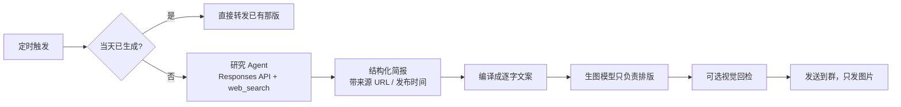

<div align="center">


# 每日图报

给自己的 QQ 群做一份每天准点送达的「报纸」。

<sub>AstrBot 插件 · 早 08:00 / 午 12:30 / 晚 19:00 · 研究 Agent 联网核实 → 生成竖版报纸图 → 推群</sub>

</div>

---

## 先说清楚

这是我**自己用**的插件，跑在自己群的 AstrBot 上，每天往「**吴某的乐子群**」发早报、午报、晚报。写出来顺手开源，主要是留个备份，也方便以后换机器重装。

所以：

- 默认配置都是围着我这一个群调的（刊名、右上角 `@吴某的乐子群`、三个时段），你要用得改一遍；
- 它不是「通用资讯推送器」，我也不打算做成大而全的产品；
- 代码里没什么花活，就是把「查资料 → 排版 → 发图」这条链路走稳，别每天翻车。

## 它长这样

群里收到的是这样一张竖版图（1024×1536，手机上直接看）：

<a href="docs/images/sample-morning.webp"></a>
<a href="docs/images/sample-noon.webp"></a>

三个时段侧重不一样：

| 时段 | 时间 | 内容 |
|---|---|---|
| 早报 | 08:00 | 昨夜至今晨的国际要闻，政治外交 / 战争安全 / 灾害 / 经济 / 科技 / 社会文化，外加历史上的今天 |
| 午报 | 12:30 | 上午的财经、产业、科技 AI、能源与监管动向 |
| 晚报 | 19:00 | 白天事件的后续结果、社会文化、明日关注 |

在 AstrBot WebUI 里就是普通插件，指令也都是常规命令：

<a href="docs/images/ui-plugin-detail.webp"></a>

## 一个前提：生图模型不会查新闻

这点值得单独写，因为踩过坑。

`gpt-image-2`、`hunyuan-image-alpha` 这类文生图模型**不联网、不能核实**。直接让它「画今天的新闻」，它会一本正经编出看起来合理、但查无此事的标题。所以链路是拆开的：



**查和写归研究模型，画归生图模型。** 简报里每条重点新闻都带 `source` / `url` / `published_at`，研究请求必须真的出现 `completed` 的 `web_search_call`，否则直接判失败 —— 宁可当天不出报，也不发编的新闻。

即便这样，模型仍会误读、错归因、引用旧稿。插件保证的是「可追溯」，不是「已核实」，敏感内容还请自己抽查。

## 装上试试

要求 AstrBot ≥ 4.29.1、Python ≥ 3.11，群里需要支持主动消息的 NapCat / OneBot v11 连接（QQ 官方机器人不支持定时推送）。

```text
# WebUI → 插件 → 从 URL / GitHub 安装，填：
https://github.com/Cnxiaohun/astrbot_plugin_daily_image_report

# 或手动放目录
cd AstrBot/data/plugins
git clone https://github.com/Cnxiaohun/astrbot_plugin_daily_image_report
```

然后在插件配置里填两样：

| 配置项 | 说明 |
|---|---|
| `api.base_url` | OpenAI 兼容网关地址，默认 `http://127.0.0.1:8000` |
| `api.api_key` | 你自己的 key，**不要**提交进仓库 |

> AstrBot 跑在 Docker 里时，`127.0.0.1` 指的是容器自己，得换成宿主地址或 `host.docker.internal`。

最后在群里用管理员身份绑定：

```text
/日报 绑定 全部      # 把当前群加入三个时段
/日报 测试 早报      # 先试一张，只发到当前会话
/日报 状态
```

**没绑定群之前不会产生任何 API 调用**，这点可以放心。

## 指令

统一写法 `/日报 <动作> [时段]`，**动作和时段顺序随便**，`/日报 测试 早报` 和 `/日报 早报 测试` 效果一样。

| 指令 | 干什么 |
|---|---|
| `/日报` | 帮助 |
| `/日报 状态` | 各时段开关、目标数、下次计划、上次结果 |
| `/日报 历史 [1-20]` | 最近运行记录、`run_id`、失败原因 |
| `/日报 目标` | 当前群绑了哪些时段 |
| `/日报 测试 早报` | 只发到当前会话，不写正式记录 |
| `/日报 立即 早报` / `/日报 早报` | 发到已绑定群，当天已有图就复用 |
| `/日报 强制 早报` | 重新检索并生图（**会再计费**），唯一绕过「当天只生成一次」的入口 |
| `/日报 启用 早报` / `停用 早报` | 开关单个时段 |
| `/日报 绑定 早报` / `绑定 全部` | 当前群加入该时段 |
| `/日报 解绑 早报` / `解绑 全部` | 从该时段移除当前群 |
| `/日报 重发 <run_id> [确认]` | 复用旧图重发；带 `确认` 才允许重发「结果不明」的目标 |

时段能写 `早报/早/早上`、`午报/午/中午`、`晚报/晚/晚上`，也能写 `morning/noon/evening`。旧写法 `/日报测试 早报`、`/日报绑定 全部` 也还能用。

拼错不会被当成「立即发布」—— 比如 `/日报 强制重做 早报` 会提示「无法识别的参数『强制重做』；是不是『强制』？」，不会偷偷扣一次生图费用。

## 几个我自己在意的细节

**当天只生成一次。** 同一天同一时段，第二次触发不再调 API，而是把已经做好的那版转发出来。想重做只有 `/日报 强制` 一条路。

**不重复发。** 每个群每次发送都有持久化收据，`sent` / `sending` / `uncertain` 分得清楚。发送时抛异常会记成 `uncertain` 并且**不自动重发** —— 宁可不补，也不要群里出现两张一样的报纸。进程重启也不会重发已成功的。

**失败不再沉默。** 早期版本告知发出去、生成失败，群里就再没下文了（我自己踩过一次：早上看到提示，图一直没来）。现在失败会补一句卡在哪个阶段、原因摘要、怎么重试。

**跨刊去重。** 早/午/晚之间会传递当天已出刊物的标题和 `event_key`，同一事件没有实质新进展不许重复出现，只有标 `UPDATE` 才能再写一遍。

**生成前先用当前人格说一声。** 会调一次很短的模型请求，把「开始做 2026-11-12（星期四）12:30 的午报」改写成群里那个人格的口吻；改不动就退回原句，不影响生成。正式推送仍然只发图片。

## 配置速查

<details>
<summary><code>schedules</code> / <code>announce</code> / <code>research</code> 常用项</summary>

| 键 | 默认 | 说明 |
|---|---|---|
| `schedules.morning.time` | `08:00` | 时段 HH:MM |
| `schedules.morning.mode` | `agent` | `agent` 联网研究；`static` 用固定提示词（需自填 `image_prompt`） |
| `schedules.morning.targets` | `[]` | 目标群 UMO，群内 `/日报 绑定` 会自动填 |
| `schedules.morning.research_prompt` | 空 | 留空用内置早报模板 |
| `schedules.morning.image_prompt` | 空 | 留空用内置报纸版式模板 |
| `api.size` | `1024x1536` | 竖版；部分网关不严格遵守，记录以实际输出为准 |
| `api.fallback_image_models` | `["hunyuan-image-alpha"]` | 主模型失败时按顺序兜底 |
| `research.model` | `codex/gpt-6.1-sol` | 需要支持 Responses API 的 `web_search` |
| `research.timeout_seconds` | `240` | 研究超时；超时会自动重试一次 |
| `announce.enabled` | `true` | 生成前是否在群里说一声 |
| `announce.use_persona` | `true` | 是否用当前人格改写告知语 |
| `announce.notify_on_failure` | `true` | 失败是否在群里说明 |
| `qa.enabled` | `false` | 视觉回检图片文字，会增加耗时和成本 |
| `limits.max_concurrent_generations` | `1` | 同时进行的生图任务数 |

模板占位符用 `{{date}}`、`{{slot_name}}`、`{{cover.headline}}` 这类双花括号，只做简单替换，**不支持循环和条件**；写错的占位符会直接报错，不会静默变空。

</details>

## 数据与安全

数据在 `AstrBot/data/plugin_data/astrbot_plugin_daily_image_report/`：

```text
state.json                     运行索引与发送收据
runs/20261112-morning-xxxxxxxx/
    meta.json  brief.json  evidence.json
    research_prompt.txt  image_prompt.txt  image.png  qa.json
```

默认保留 7 天。`state.json` 损坏时插件会拒绝启动而不是重置 —— 去重历史丢了比不启动更危险。

几个刻意的取舍：

- API Key 只存在 AstrBot 配置里，插件不写日志、不写运行元数据、不进仓库；配置里的 `secret: true` 只是 WebUI 遮罩，并不加密；
- 生图返回的图片 URL 只允许公网地址，下载不带 `Authorization`，限制大小与重定向；
- 管理指令要求 AstrBot 管理员权限，不把 QQ 群管自动当成机器人管理员。

## 测试

```bash
python -m unittest discover -s tests    # 95 项
```

覆盖了并发重发不重复、研究失败不降级编造、SSRF 拦截、收据持久化、拼错指令不误发布这些我认为最容易出事的地方。跑真实 API 的预览脚本在 `tools/preview.py`，**只生成不发群**：

```bash
export DAILY_REPORT_API_KEY='你的key'
python tools/preview.py --slot morning --base-url http://127.0.0.1:8000 --output ./preview-output
```

## 已知不足

- 只在 AstrBot 4.29.3 + NapCat 上真机跑过，其他平台没验证；
- 研究这一步要 2–4 分钟，加上生图几十秒，**从触发到收到图有几分钟延迟**，不是「准点弹出来」；
- 去重靠 `event_key` 和标题比对，属于提示机制，不是确定性事实引擎；
- 备用混元会带平台水印，插件不去掉它。

## 鸣谢

- **OpenAI** —— `gpt-image-2` 渲染中文版面，Responses API 的 `web_search` 撑起整条研究链路。这个插件基本是踩着它的能力边界写出来的；README 里的头像和吉祥物也是它画的。
- **Qoder** —— 开发中大量实现和重构是在 Qoder 的 Agent 里完成的，包括客户端重试策略、并发锁，以及那些安全边界。
- **DeepSeek** —— 长上下文代码审阅和边界情况推演，帮我提前填了不少坑。

以及 [AstrBot](https://github.com/AstrBotDevs/AstrBot) 本体 —— 插件文档写得比很多商业项目清楚。

## License

[MIT](LICENSE)
